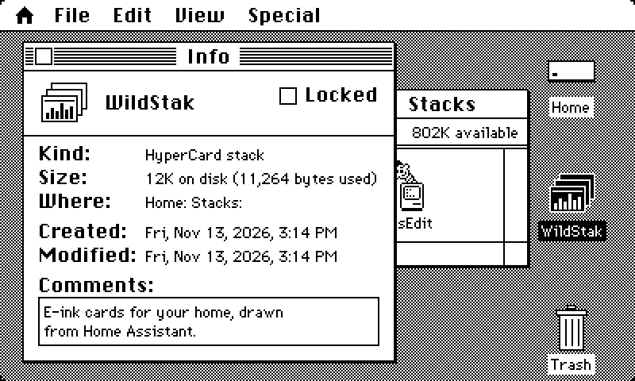
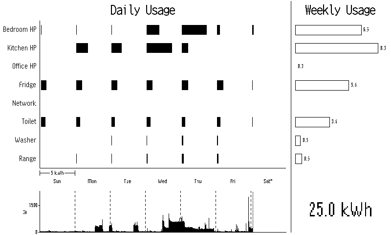
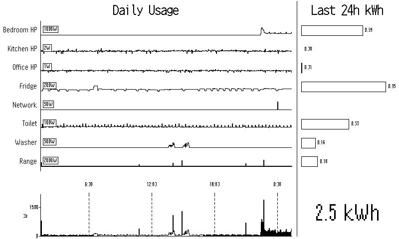

# WildStak

E-ink energy cards for your home, drawn from Home Assistant, for the
[Seeed reTerminal E1001](https://wiki.seeedstudio.com/reterminal_e10xx_with_esphome/).

A script on a server renders 800×480, 1-bit PNG "cards" from your Home
Assistant data. The reTerminal wakes on a schedule, downloads only the cards
that changed, and shows them in rotation, deep sleeping in between. Two cards
come with it, both drawing from the same list of devices, which you pick
from your own energy sensors. These are real ones, at the panel's own
resolution:

**Weekly energy:** a day-by-day grid of each device's usage, a 7-day
sparkline of total power, and each device's total for the week.



**Daily energy:** a 24-hour power plot per device, total power with night
shaded, and each device's kWh over the last 24 hours.



More cards are a Python script each: see [DASHBOARD_SPEC.md](DASHBOARD_SPEC.md).

## How it works

```
[HA sensors] --> dashboards/*_dashboard.py --> docs/media/*.png --+
                                                                   +--> docs/ on any web server
                 make --> docs/data/dashboards.txt (manifest) ----+            |
                                                                               v
                            Home Assistant <-- MQTT --> reTerminal E1001 (firmware/)
```

- `make`, run from cron, renders every card and writes a manifest listing
  each card's URL and a hash of its pixels.
- The device syncs on a fixed grid (hourly at :05 by default): it fetches the
  manifest, downloads cards whose hash changed into a flash cache, and goes
  back to sleep. Between syncs it rotates through the cached cards with the
  radio off, each a partial refresh of about a second.
- Settings (rotation interval, sync period, deep sleep, ...) are controls on
  the device's page in Home Assistant, and readings (battery, temperature,
  humidity, Wi-Fi, last sync) go back the same way, over MQTT. The device
  starts every connection, so nothing waits for it to wake up.

[NOTES.md](NOTES.md) has the design, the measurements behind it, and the
hardware quirks that make this panel differ from Seeed's own docs.

## What you need

- A reTerminal E1001 and a USB-C cable for the first flash.
- Home Assistant with energy sensors (cumulative kWh; a live W sensor per
  device too, ideally), and its
  [MQTT integration](https://www.home-assistant.io/integrations/mqtt/) with
  a broker, e.g. the
  [Mosquitto broker app](https://github.com/home-assistant/apps/blob/master/mosquitto/DOCS.md)
  (formerly an add-on). See step 2 if you don't have MQTT yet.
- A Linux machine to run `make` on a schedule (Python 3.11+, GNU make,
  `sha256sum`), and a web server the device can reach that serves the
  `docs/` directory. Tested over HTTPS; plain HTTP on a LAN should work
  too (and saves a TLS handshake per card), but hasn't been tried.
- [ESPHome](https://esphome.io/) to build the firmware. Tested with 2026.9.0.

## Setup

### 1. Cards

```sh
git clone https://github.com/ryneches/wildstak.git
cd wildstak
python3 -m venv .venv
.venv/bin/pip install -r requirements.txt
cp dashboards/config.example.toml dashboards/config.toml
```

Create a Home Assistant long-lived access token (your HA profile, Security
tab) and save it, alone, in a file called `.env` in the repo root. Then list
your sensors:

```sh
.venv/bin/python tools/ha_sensors.py --ha-url http://homeassistant.local:8123
```

It pairs each kWh sensor with its W sensor and prints `[[entities]]` tables.
Paste the ones you want into `dashboards/config.toml`, shorten the labels
(the label column is 80 px), and set `ha_url` and `timezone` there too.

Then tell `make` where the cards will be served, and render them:

```sh
echo 'BASE_URL = http://myserver.lan/wildstak' > local.mk
make
```

`docs/media/` now holds the PNGs and `docs/data/dashboards.txt` the
manifest. Serve `docs/` at `BASE_URL` (any static web server; for a quick
test, `python3 -m http.server -d docs`), and run `make` from cron a few
minutes before the device syncs:

```
0 * * * * make -C /path/to/wildstak
```

If you use [Zensical](https://zensical.org/), `make site` also writes an
index page and builds the site.

### 2. Home Assistant

If you don't have MQTT running yet, Home Assistant's
[MQTT integration docs](https://www.home-assistant.io/integrations/mqtt/)
walk through it. On Home Assistant OS, install the
[Mosquitto broker app](https://github.com/home-assistant/apps/blob/master/mosquitto/DOCS.md)
(Settings > Apps), then add the MQTT integration it offers. On a Container
or Core install there are no apps: run a broker yourself (Mosquitto is the
usual choice) and point the integration at it.

Then give the device an MQTT login on your broker (with the Mosquitto app, a
Home Assistant user works). Nothing else: the device announces itself through
MQTT discovery on its first sync.

### 3. Firmware

```sh
cd firmware
cp secrets.example.yaml secrets.yaml   # Wi-Fi, OTA password, MQTT password
cp device.example.yaml device.yaml     # manifest URL, MQTT broker, timezone
esphome run device.yaml
```

Flash over USB the first time: the firmware uses its own partition table and
bootloader settings, which only a serial flash installs. After that, OTA
works while the device is in service mode.

`wildstak.yaml` is the shared base; keep your settings in `device.yaml`
(gitignored), which overrides it, so updates don't conflict.
`device.example.yaml` also shows how to add a static IP (faster syncs) or
MQTT over TLS.

### Using it

- **White buttons:** next / previous card.
- **Green button:** service mode. Wi-Fi on, a sync right away, and a status
  screen (last sync, battery, network, settings) with a countdown; the device
  stays reachable for OTA and logs until it runs out. Green again for more
  time, white to go back to the cards.
- **Home Assistant:** the device page has the settings (rotate interval,
  sync period and offset, service mode time, full refresh every, deep sleep)
  and the readings. Changes reach the device at its next sync.

## Repository

| Path | What |
|---|---|
| `dashboards/` | Card scripts, the shared `dashboardlib.py`, config, fonts |
| `firmware/` | ESPHome config, C++ headers, the vendored display driver |
| `tools/` | `ha_sensors.py` (pick sensors), `masthead.py` (draws the masthead) |
| `assets/` | The masthead and the card images in this README |
| `Makefile` | Renders cards and the manifest |
| `NOTES.md` | Design, measurements, hardware quirks |
| `DASHBOARD_SPEC.md` | How to write a new card |

## License

GPL-3.0; see [LICENSE](LICENSE). Also included, under their own terms:

- **Display driver** (`firmware/components/waveshare_epaper/`): from
  [parkghost/esphome-epaper](https://github.com/parkghost/esphome-epaper),
  Apache-2.0, modified; its README lists the changes. Its base classes appear
  to derive from ESPHome's own `waveshare_epaper` (GPLv3), which this
  license covers either way.
- **Fonts** (`dashboards/fonts/`): x12y16pxMaruMonica by hicc (hicc's own
  license, which allows redistribution) and EnkaDotGothic24 by Enthiesia
  (SIL OFL 1.1). Details in that directory's README.
- **Masthead:** drawn by `tools/masthead.py` as an homage to System 6.
  Chicago, Geneva and the ResEdit icon are Apple's designs: the fonts aren't
  included, and only the visible part of the icon is.

## Credits

[TRMNL](https://github.com/usetrmnl/trmnl-firmware),
[fabianwimberger/reterminal-e1001-weather](https://github.com/fabianwimberger/reterminal-e1001-weather)
and [mehdisadeghi/reterminal-e1001-esphome](https://github.com/mehdisadeghi/reterminal-e1001-esphome)
for the wake/sleep patterns; Seeed's
[GxEPD2 example](https://github.com/Seeed-Projects/OSHW-reTerminal-Series-E-D)
for revealing which panel the E1001 actually has.
